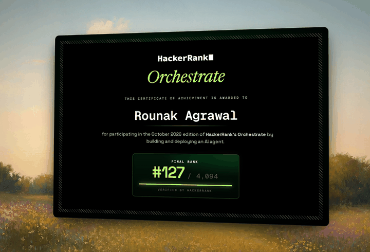

# Ghost Data Audit Agent

*An evidence-first agent for answering one deceptively simple question: when a person asks for their data to be deleted, how do we know it is really gone?*



Built solo for **HackerRank Orchestrate — October 2026**, on the challenge **“Ghost Data Still Exists.”** I finished **#127 out of 4,094 participants (top 3.1%)**.

---

## Why I built this

A deletion workflow can say `Complete` and still leave personal data behind. A copy might remain in a database replica, a support attachment, an export, an analytics index, an archive, or a backup. A sync or restore process can even bring a record back after it has been deleted from its original system.

The challenge was to investigate that gap using a deliberately messy evidence pack: SQL snapshots, JSON exports, several kinds of logs, ledgers, screenshots, and PDFs. The task covered **518 deletion requests**. For each one, the agent had to decide whether deletion was actually requested, work out what data still existed at the audit time, apply the relevant policy, and produce an ordered plan with evidence behind every finding.

I wanted the system to behave less like a chatbot giving a confident answer and more like an auditor showing its working. A conclusion should be traceable to a record, a timestamp, and a rule. When the evidence is not enough, the system should say less rather than fill the gap with a guess.

## At a glance

| | |
|---|---|
| Challenge | HackerRank Orchestrate — October 2026 |
| Result | **#127 / 4,094 — top 3.1%** |
| Requests processed | **518** |
| Evidence readers | **8 specialised adapters** |
| Possible outcomes | `COMPLETE`, `INCOMPLETE`, `NOT_APPLICABLE` |
| Main implementation | Python 3; standard library for the core pipeline |
| Optional model provider | Anthropic API |
| Output | `output.csv` — one row per request |

## What the agent does

For every request, the agent:

1. Checks whether the person actually asked for deletion. A request to update an email address, download data, or change marketing preferences is not automatically a deletion request.
2. Resolves the person using current and historical identity information, including email addresses, phone numbers, email hashes, and user IDs.
3. Reads the supplied evidence and connects records to the person without relying on names alone.
4. Reconstructs the state of each resource at that request's `audit_at` time.
5. Applies the relevant rule from `deletion_rules.csv` — for example, delete, redact, anonymise, retain, block restore, or disable a data flow.
6. Produces findings, remediation actions, and verification steps in the required order, with evidence references wherever a finding can be supported.

The output status has three possible values:

- **`COMPLETE`** — the required end states are verified by eligible evidence.
- **`INCOMPLETE`** — the agent finds a citable policy violation, an unverified deletion requirement, or no sufficiently supported state to establish completion.
- **`NOT_APPLICABLE`** — the request is not actually asking for deletion; its `steps_json` is `[]`.

## How it works

The core pipeline is deliberately split into small stages. The evidence is normalised first; each request is then evaluated against that shared fact store.

```text
dataset/
   │
   ▼
loaders ──► 8 evidence adapters ──► in-memory SQLite fact store
                                          │
request ──► intent ──► identity resolution │
                         │                │
                         ▼                ▼
                  time-aware dossier at audit_at
                              │
                              ▼
                       policy engine
                              │
                              ▼
                findings + remediation + verification
                              │
                              ▼
                          output.csv
                              │
                              ▼
                    evaluation / invariants
```

### 1. Read different evidence formats consistently

The eight adapters turn different source formats into a common set of observations. They recognise files from their structure, not just their filenames.

| Adapter | Evidence it handles |
|---|---|
| `replica_sql` | SQL replica snapshots |
| `snapshot_bundle` | Snapshot bundles |
| `service_export` | Service exports and JSON bundles |
| `inventory_sql` | Inventory SQL records |
| `observability_log` | Observability logs |
| `trace_log` | Trace and request logs |
| Ledger readers | JSON, log, and plain-text ledgers |
| `multimodal` | Screenshots and PDFs |

Each reader extracts observations such as the resource, its state, the timestamp on the record, and identifiers that may connect it to a person. The adapters write those facts into a shared, in-memory SQLite store. They do not make the final deletion decision.

### 2. Resolve identities using evidence

An email in a deletion request is matched against the current identity snapshot and the historical identity audit log. That gives the agent a set of current and former identifiers to search for in older systems.

The implementation uses exact identifier matches and supported joins. A name on its own is not enough to link a resource to someone. Where evidence does not support an account link, the default is to omit the guessed account step rather than invent a connection.

### 3. Respect both clocks

One of the most important design decisions is the **two-clock rule**:

- The timestamp on a record (`record_at`) determines whether that observation can be used to reconstruct state and link a resource at `audit_at`.
- The evidence file's manifest capture time determines whether that file is allowed to be cited for the case.

This distinction matters when a file was collected later but contains an earlier-dated record. An eligible record may help reconstruct historical state, but a file captured after `audit_at` is not used as a citation for that audit. The agent does not treat a later workflow status as proof of what was true earlier.

### 4. Apply policy in deterministic code

For each linked resource, the policy engine determines its category and required end state from `deletion_rules.csv`. Depending on the rule, that may mean deleting a record, redacting identifiers, anonymising it, retaining it, preserving a permitted tombstone, blocking a restore, or disabling an active data flow.

Activity logs and reported workflow results are treated as claims rather than proof of current state. Explicit recreation events are handled as a special case; otherwise, the latest usable observation for a resource is evaluated against the required state. Where a complete snapshot can establish absence by omission, that is handled separately from a partial export or inventory that cannot prove absence.

### 5. Produce an auditable sequence

The step generator writes the result in three phases:

1. `FINDING` — what the evidence shows.
2. `REMEDIATION` — what needs to be changed.
3. `VERIFICATION` — what must be checked afterward.

Findings cite the supporting evidence. Remediation and future verification steps in an `INCOMPLETE` case use an empty `evidence_id`, because those actions have not happened yet. Steps follow the challenge's required phase and operation ordering, and numbering starts at 1 with no gaps.

## Where the LLM fits — and where it does not

I deliberately kept the model away from the decisions that need to be auditable.

- **Request intent:** the final run used `claude-haiku-5-5` to help classify whether a request was actually asking for deletion. A deterministic prefilter catches explicit negation; that negation takes priority. If a model response is missing or fails validation, the prefilter provides the fallback.
- **Screenshots and PDFs:** these were read during development using a multimodal model. The agreed extracted facts (IDs and hashes) are stored under `code/extractions/`, so a normal run reuses those facts instead of making the same image calls again.
- **Core audit decisions:** identity linking, resource state, policy application, status, step construction, ordering, and evidence citations are handled by code. The model does not decide whether deletion is complete or invent a citation.

Optional category disambiguation is available behind `CATEGORY_LLM`, but it is **off by default**. The main pipeline can also run without an API key or with `--no-llm`; in that mode, request intent uses the deterministic prefilter.

## Results and evaluation

I kept the public-sample results, synthetic tests, and full-dataset checks separate because they answer different questions.

### Public sample evaluation

The implementation was scored against the 32 public sample answers in deterministic mode (`--no-llm`, with the default `LINK_FALLBACK=omit`).

| Metric | Result |
|---|---:|
| Deletion-status accuracy | **29 / 32 (90.62%)** |
| Step precision | **0.9684** |
| Step recall | **0.7927** |
| Step F1 | **0.8718** |
| Field accuracy on aligned steps | **1.0000** for each measured field |
| Exact sequence match | **10 / 32 (31.25%)** |

The remaining differences are documented rather than hidden. Most step-level misses come from links or evidence that the current implementation intentionally does not infer, or from evidence formats and records that are not fully covered yet. The three status mismatches are also recorded in the evaluation report.

### Custom scenarios

Six custom scenarios covering eight output rows are generated from synthetic, self-contained datasets and run through the actual CLI. **All 8 of 8 rows matched their expected results**, with no invariant violations. These tests are useful regression checks, but they are not a substitute for performance measurement on the challenge's full data distribution.

### Full 518-request run

The final run produced:

| Outcome | Requests |
|---|---:|
| `COMPLETE` | 152 |
| `INCOMPLETE` | 356 |
| `NOT_APPLICABLE` | 10 |
| **Total** | **518** |

All output invariants passed: the file had 518 unique requests in numeric case order, the required header, valid step numbering and ordering, and citations that respected the audit-time constraints.

The cold run, warm-cache rerun, and `--no-llm` run produced byte-identical `output.csv` files. The final model run did not change any status or step compared with the deterministic run.

Detailed methods, error analysis, assumptions, and measurements are in [`code/evaluation/evaluation_report.md`](code/evaluation/evaluation_report.md).

## LLM usage and cost

The numbers below come from the committed usage report. Development experiments and the final full-dataset run are kept separate.

| Run | Model usage | Recorded cost |
|---|---|---:|
| Final 518-request run | `claude-haiku-5-5`: 381 calls, 137 cache hits; 181,661 input tokens and 19,972 output tokens | **$0.0282** |
| Development experiments | Haiku intent tests plus Opus and Sonnet screenshot/PDF comparison runs | **$0.9438** |
| **Combined recorded usage** | Final run + development experiments | **$0.9720** |

For the final run, that is about **389.3 tokens per request** and **$0.000054 per request**. No screenshot or PDF model calls were made during that final run; the extracted facts were already available in `code/extractions/`.

These are measured estimates from the run logs and the model prices recorded in [`code/evaluation/usage_report.md`](code/evaluation/usage_report.md), not a claim that every possible future run will cost the same amount.

## Run it locally

### Requirements

- Python 3.
- The Python standard library is enough for the deterministic core pipeline.
- An Anthropic API key and the pinned SDK in `requirements.txt` are needed to make live model calls.
- `pdftotext` (from Poppler) is needed only if you are re-running PDF text extraction; the committed screenshot/PDF extractions are reused in a normal run.

### 1. Clone the repository

```bash
git clone https://github.com/Ragrawal2004/hackerrank-orchestrate-october26.git
cd hackerrank-orchestrate-october26
```

### 2. Run without an API key

This uses the deterministic intent prefilter and does not make LLM calls:

```bash
python3 code/main.py --no-llm
```

The command reads the files under `dataset/` and writes `output.csv` in the repository root.

### 3. Run with Anthropic intent classification (optional)

Create and activate a virtual environment, then install the pinned SDK:

```bash
python3 -m venv .venv
source .venv/bin/activate
python3 -m pip install -r requirements.txt
```

Set the API key in your shell (or in a local, uncommitted `.env` file at the repository root):

```bash
export ANTHROPIC_API_KEY="your_api_key"
python3 code/main.py
```

Do not commit `.env`, API keys, or other credentials. The repository includes `.env.example` as a reference for configuration names.

### Useful commands

```bash
# Run the full dataset with the deterministic intent fallback
python3 code/main.py --no-llm

# Run the full dataset with the configured LLM intent classifier
python3 code/main.py

# Run selected cases and write to a separate output file
python3 code/main.py --out /tmp/selected.csv --cases case_33,case_34

# Run the unit and integration tests
python3 -m unittest discover -s code/tests -t code -v

# Check the output contract and evidence-time invariants
python3 code/evaluation/main.py --invariants --pred output.csv

# Run the six custom evaluation scenarios
python3 code/evaluation/main.py --custom
```

To score the 32 public samples, make a temporary copy of the dataset, replace its `deletion_requests.csv` with `sample_deletion_requests.csv`, run the pipeline against that temporary directory, and compare its output with `dataset/sample_output.csv`:

```bash
mkdir -p /tmp/ghost-samples
cp -R dataset/. /tmp/ghost-samples/
cp dataset/sample_deletion_requests.csv /tmp/ghost-samples/deletion_requests.csv
python3 code/main.py --dataset /tmp/ghost-samples \
  --out /tmp/ghost-samples/predictions.csv --no-llm
python3 code/evaluation/main.py \
  --pred /tmp/ghost-samples/predictions.csv \
  --gold dataset/sample_output.csv
```

## Configuration

CLI flags take precedence over environment variables.

| Setting | Purpose | Default |
|---|---|---|
| `ANTHROPIC_API_KEY` | Enables live Anthropic API calls | Not set |
| `LINK_FALLBACK` | Whether to omit or opt into low-confidence account-link guesses | `omit` |
| `CATEGORY_LLM` | Enables optional LLM category disambiguation | `off` |
| `GHOST_INTENT_MODEL` | Request-intent model | `claude-haiku-5-5` |
| `GHOST_CATEGORY_MODEL` | Optional category model | `claude-haiku-5-5` |
| `GHOST_SCREENSHOT_MODEL` | Screenshot/PDF extraction model | `claude-opus-5-5` |
| `GHOST_RUNS_DIR` | Diagnostics, usage log, and response-cache directory | `runs/` |
| `GHOST_EXTRACTIONS_DIR` | Location of cached multimodal extractions | `code/extractions/` |

Useful command-line flags:

- `--dataset DIR` — use a different dataset directory.
- `--out FILE` — write the output to a different path.
- `--cases IDS` — run a comma-separated list of case IDs.
- `--link-fallback omit|guess` — override the account-link fallback mode.
- `--category-llm off|on` — override optional category disambiguation.
- `--no-llm` — disable live model calls.
- `--cold` — ignore cached LLM responses for the run.

## Repository layout

```text
.
├── code/
│   ├── ghost/                 # Pipeline, adapters, identity, policy, LLM gateway
│   ├── tests/                 # Unit and end-to-end tests
│   ├── evaluation/            # Scoring, invariants, custom cases, reports
│   ├── extractions/            # Agreed facts extracted from screenshots and PDFs
│   └── prompts/               # Prompts for intent and multimodal extraction
├── dataset/                   # Challenge inputs and evidence files
├── docs/
│   ├── SPEC.md                # Working interpretation of the challenge contract
│   ├── DESIGN.md              # Design decisions and data model
│   └── ASSUMPTIONS.md         # Assumptions, impact, and open questions
├── ARCHITECTURE.md            # Short architecture and module map
├── AGENTS.md                  # Instructions for AI coding agents
├── CLAUDE.md                  # Claude Code project notes
├── problem_statement.md       # Challenge statement
├── requirements.txt           # Pinned optional Anthropic SDK
└── README.md
```

## Known limitations and trade-offs

I chose conservative linking and evidence rules, but that also means the implementation has gaps. The most important ones are documented in [`docs/ASSUMPTIONS.md`](docs/ASSUMPTIONS.md) and the evaluation report:

- With `LINK_FALLBACK=omit` (the default), **272 cases do not receive an account verification step** when the available evidence does not establish a safe account link. This avoids guessing, but it can leave a verification step out.
- Four text evidence files (`evidence_56`, `evidence_57`, `evidence_59`, and `evidence_61`) are not currently read by the adapters. They affect a small number of the public sample cases.
- In `evidence_58`, `support_001` appears without a supporting identifier elsewhere in the participant-facing files, so the current known-ID rule does not link it. This is discussed in the sample error analysis.
- Some policy/category interpretations rely on documented assumptions where the challenge evidence is incomplete. The assumptions audit records which ones are supported by samples and which remain uncertain.

I have left these limitations visible because a useful audit system should make its uncertainty inspectable, not hide it behind a confident status.

## Challenge submission notes

The challenge submission and this GitHub repository serve different purposes:

- `output.csv` is generated in the repository root by `python3 code/main.py` and can be uploaded separately to the challenge's output slot.
- `log.txt` is the AI-agent chat transcript requested by the challenge. Keep it local and upload it to the `chat_transcript` slot; it does not need to be part of this public GitHub repository.
- `code.zip` should contain the runnable solution, prompts, configuration, this `README.md`, and the evaluation reports. It should **not** contain the dataset, virtual environments, caches, credentials, or nested archives.

From the repository root, the package can be created with:

```bash
zip -r code.zip README.md ARCHITECTURE.md problem_statement.md docs code \
  requirements.txt .env.example \
  -x "*/__pycache__/*" "*/.venv/*" "*/venv/*" \
     "*/node_modules/*" "*/.git/*" "*/.DS_Store" \
     "*.zip" "*.tar" "*.gz" "*.tgz" "*.7z" "*.rar"
```

Before submitting, check that `output.csv` has the exact header `case_id,deletion_status,steps_json`, contains one row for every request, and passes the invariant checker. Also make sure no API keys, credentials, or personal data have entered the repository or submission files.

## A few notes before you dive into the code

If you want to understand the project without reading every module first, I would start here:

1. [`ARCHITECTURE.md`](ARCHITECTURE.md) for the pipeline and module map.
2. [`docs/DESIGN.md`](docs/DESIGN.md) for the reasoning behind the data model and evidence rules.
3. [`docs/SPEC.md`](docs/SPEC.md) for the challenge contract and implementation decisions.
4. [`docs/ASSUMPTIONS.md`](docs/ASSUMPTIONS.md) for the places where the evidence is incomplete and the trade-offs are explicit.
5. [`code/evaluation/evaluation_report.md`](code/evaluation/evaluation_report.md) and [`code/evaluation/usage_report.md`](code/evaluation/usage_report.md) for the measured results and model usage.

Thanks for taking a look. I built this in a 24-hour challenge, but the central lesson is one I want to keep using in future AI systems: **a useful agent should be able to show why it reached an answer, not just produce one.**
